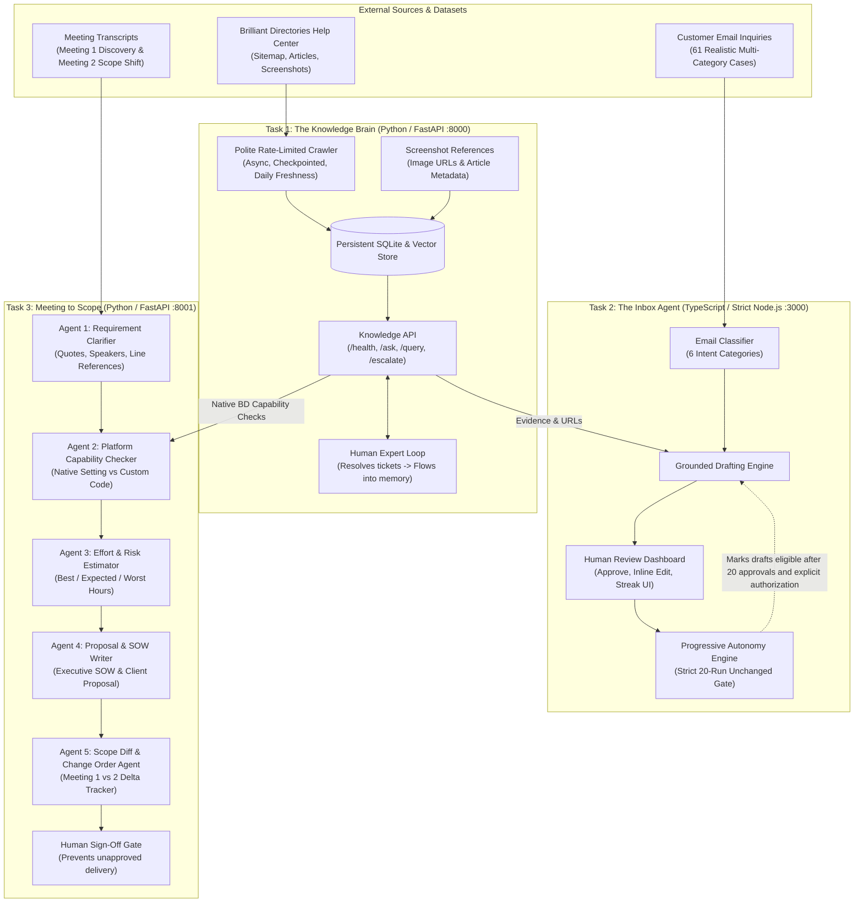

# System Design Document: AI Tech Consultant
**Candidate Capstone Project | BusinessLabs & Anthropic**

---

## 1. The Business Problem in Plain English

AI coding tools make routine implementation more accessible and put pressure on agencies to deliver faster while protecting trust and margins. This project focuses on three operational bottlenecks around software work:

1. **Product Knowledge Friction (Task 1)**: Platforms like Brilliant Directories expose many settings across large help centers. Solutions engineers spend time searching documentation and interpreting screenshot guides. As articles change, staff can give inconsistent answers.
2. **Support Inbox Overhead (Task 2)**: Support engineers repeatedly answer the same inquiries, struggle to maintain company voice, and risk making unverified promises. Without an audit trail and safeguards, fully autonomous sending risks sending bad advice to high-value clients.
3. **Meeting-to-Scope Conversion (Task 3)**: Discovery meetings with clients are messy and imprecise ("make search better"). Translating conversational speech into atomic developer tasks, risk-rated hour estimates, and client-facing proposals takes days. Crucially, **many client requests can be solved natively through existing platform settings (zero custom code)**. If an agency quotes 20 hours of custom coding for something that is a native toggle, they lose the deal or breach trust. Furthermore, follow-up meetings invariably change requirements, leading to unquoted scope creep and lost revenue.

The **AI Tech Consultant** addresses these bottlenecks through three decoupled services that share product knowledge over HTTP.

---

## 2. System Architecture & Task Connections

### Architectural Decoupling
Tasks 2 and 3 communicate with Task 1 **strictly over HTTP REST calls** (`POST /api/v1/ask` and `GET /health`), never importing or sharing code. This guarantees that Task 1 can be replaced, scaled, or upgraded independently without modifying Tasks 2 or 3.

---

## 3. Features Chosen vs. Features Dropped

### Features Chosen & Rationale
1. **Polite Sitemap Crawler with Checkpointing (Task 1)**: The crawler uses a fixed 0.5-second delay between requests and saves resume state in `crawler_state`. The delay reduces request rate; it does not guarantee that a remote site will allow or complete a crawl.
2. **Screenshot References (Task 1)**: Article image URLs and available metadata are stored alongside text chunks so responses can return relevant screenshot references. The system does not perform OCR or visual understanding of screenshot contents.
3. **Calibrated Escalation Feedback Loop (Task 1)**: Rather than hallucinating when knowledge is absent, queries below threshold generate an escalation ticket. When an expert resolves the ticket, the resolution is automatically indexed into memory, demonstrating continuous self-evolution.
4. **Strict 20-Run Progressive Autonomy Gate (Task 2)**: Autonomous AI email sending without human supervision creates severe liability. Requiring **20 consecutive unedited human approvals** per category proves drafting quality before unlocking autonomy, while any edit or rejection instantly resets the counter to 0.
5. **Cross-Examination of Requirements against Platform Settings (Task 3)**: Before estimating custom development, every requirement is checked against Task 1's API. A native setting receives a 1.0-hour configuration estimate. The estimator also assumes 14 avoided custom-development hours per native requirement at a fixed $75/hour rate. For three native requirements, that produces a modeled 42 hours / $3,150 figure. These are hard-coded estimating assumptions, not measured or verified client savings; the assumptions are not the same as the 16-hour custom estimate used for some feature types.
6. **Granular Meeting 1 vs. Meeting 2 Scope Diffing (Task 3)**: Discovery meetings always shift. Comparing transcripts against the baseline SOW categorizes items into `UNCHANGED`, `MODIFIED`, `REMOVED`, `DEFERRED`, and `OUT_OF_SCOPE`, automatically calculating Change Order budgets.

### Features Dropped & Rationale
1. **Distributed Vector Database Clusters (Milvus / Qdrant / Pinecone)**: Dropped in favor of self-contained SQLite + scikit-learn TF-IDF cosine similarity. For an MVP help center of ~1,500 articles, distributed clusters introduce external network dependencies, memory overhead, and setup fragility during live review.
2. **Direct SMTP Autonomous Outbound Dispatching**: Dropped to protect against accidental email spamming during evaluation. The system tracks auto-send eligibility and has an explicit system-level authorization toggle (`allowAutonomousSend`), but it does not include a mail transport or dispatch endpoint.
3. **Unchecked Fully Autonomous Proposal Delivery**: Dropped because client contracts carry financial and legal liabilities. Human review and sign-off are strictly required before client delivery.

---

## 4. Runtime Approaches and Model Evidence

| Component | Implemented approach | Optional model use | Evidence available |
|---|---|---|---|
| **Task 1: QA & Citations** | TF-IDF retrieval and evidence-grounded synthesis | Anthropic is called when `ANTHROPIC_API_KEY` is configured; otherwise deterministic synthesis is used. | Local test suite and 20-case offline evaluation. No controlled live-model comparison or cost measurement is recorded. |
| **Task 2: Email Drafter** | Pattern-based intent classifier and template-based grounded drafter | None in the current implementation. | TypeScript tests and 20-email intent evaluation. |
| **Task 3: Meeting to Scope** | Deterministic Python agents with Task 1 HTTP checks | None in the current implementation. | Pipeline tests and 20-requirement platform-check evaluation. |

The previous project notes named Claude models and reported live latency and costs, but no reproducible comparison harness or run records are present in this repository. Those figures are not treated as measured results. A live model comparison remains a candidate follow-up evaluation.

---

## 5. What Breaks: Edge Cases & Failure Modes

1. **Cloudflare WAF on Live Sitemap**: If Brilliant Directories activates aggressive Cloudflare captcha, live scraping may return 403. **Mitigation**: A curated seed dataset keeps core questions available offline; it does not guarantee full or current live-site coverage.
2. **Semantic False Positives**: Broad technical terms (e.g. "API") could score close to threshold. **Mitigation**: Calibrated confidence threshold (0.20) and explicit domain negative checks prevent custom code requests from being misclassified as native settings.
3. **Draft Tone Degradation**: An agent might draft an overly robotic response for an angry customer. **Mitigation**: The Progressive Autonomy Engine resets the category streak to 0 if a human edits or rejects the draft. Task 2 review/audit history and approval streaks are process-local and are lost when Task 2 restarts. Task 3 SOW approvals are held in `pipeline.sow_cache` and are also lost when Task 3 restarts.

4. **Knowledge Freshness Scheduling**: FastAPI starts one background scheduler that runs the existing batched incremental sitemap sync at startup and after each configured interval (daily by default). It preserves `lastmod` checks and add/update/delete handling, shares a lock with manual syncs, logs failures, and stops with the application. Set `TASK1_SCHEDULED_SYNC_ENABLED=false` to disable it or `TASK1_SCHEDULED_SYNC_INTERVAL_SECONDS` to change the interval.

---

## 6. What to Build Next (Future Roadmap)

1. **Multimodal Screenshot OCR & Vector Embeddings**: Ingest live screenshots through CLIP / Claude Vision to vectorize image text directly into multimodal vector space.
2. **Real-Time Gmail / Outlook OAuth2 Webhooks**: Connect the Inbox Agent directly to corporate email inboxes via Microsoft Graph / Google Workspace API.
3. **Automated Jira / Linear Sprint Generation**: Convert approved SOW task lists directly into epic stories and subtasks in Jira or Linear with developer assignments.
