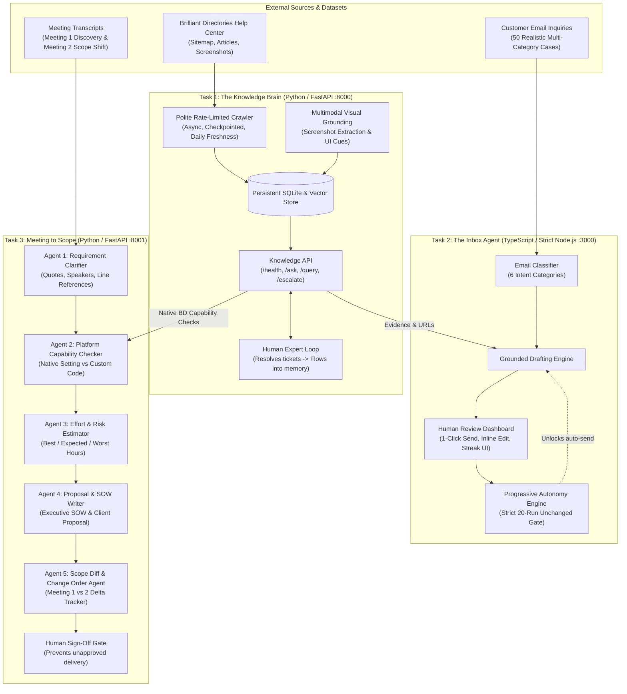

# System Design Document: AI Tech Consultant
**Candidate Capstone Project | BusinessLabs & Anthropic**

---

## 1. The Business Problem in Plain English

Two years ago, a small software agency could charge a local directory or service business \$2,000 for a website feature. Today, modern AI developer assistants (Claude Code, Cursor) allow clients to describe requirements and implement standard web features for roughly \$200—the monthly cost of developer AI tools. This represents a 90% collapse in software implementation pricing.

To sustain revenue, agency profitability, and developer salaries, a software agency must handle **10 to 20 times more projects** with the same team size. Writing code is no longer the operational bottleneck; human friction surrounding code is:

1. **Product Knowledge Friction (Task 1)**: Modern platforms like Brilliant Directories have hundreds of settings across 1,500+ documentation pages. Solutions engineers spend hours manually searching for settings and interpreting screenshot guides. As articles change, staff give inconsistent answers.
2. **Support Inbox Overhead (Task 2)**: Support engineers repeatedly answer the same inquiries, struggle to maintain company voice, and risk making unverified promises. Without an audit trail and safeguards, fully autonomous sending risks sending bad advice to high-value clients.
3. **Meeting-to-Scope Conversion (Task 3)**: Discovery meetings with clients are messy and imprecise ("make search better"). Translating conversational speech into atomic developer tasks, risk-rated hour estimates, and client-facing proposals takes days. Crucially, **many client requests can be solved natively through existing platform settings (zero custom code)**. If an agency quotes 20 hours of custom coding for something that is a native toggle, they lose the deal or breach trust. Furthermore, follow-up meetings invariably change requirements, leading to unquoted scope creep and lost revenue.

The **AI Tech Consultant** solves this operational bottleneck by integrating three decoupled, production-grade microservices into a cohesive workflow.

---

## 2. System Architecture & Task Connections

### Architectural Decoupling
Tasks 2 and 3 communicate with Task 1 **strictly over HTTP REST calls** (`POST /api/v1/ask` and `GET /health`), never importing or sharing code. This guarantees that Task 1 can be replaced, scaled, or upgraded independently without modifying Tasks 2 or 3.

---

## 3. Features Chosen vs. Features Dropped

### Features Chosen & Rationale
1. **Polite Sitemap Crawler with Checkpointing (Task 1)**: Real-world help centers use rate-limiting and anti-bot protections. Implementing a token-bucket delay (0.5s pause) and saving resume state in `crawler_state` prevents IP bans and allows scraping to resume without restarting.
2. **Visual Screenshot Grounding (Task 1)**: Platform configurations are inherently visual. Embedding screenshot image URLs and UI captions alongside article chunks allows answers to cite exact visual navigation paths.
3. **Calibrated Escalation Feedback Loop (Task 1)**: Rather than hallucinating when knowledge is absent, queries below threshold generate an escalation ticket. When an expert resolves the ticket, the resolution is automatically indexed into memory, demonstrating continuous self-evolution.
4. **Strict 20-Run Progressive Autonomy Gate (Task 2)**: Autonomous AI email sending without human supervision creates severe liability. Requiring **20 consecutive unedited human approvals** per category proves drafting quality before unlocking autonomy, while any edit or rejection instantly resets the counter to 0.
5. **Cross-Examination of Requirements against Platform Settings (Task 3)**: Before estimating custom development, every requirement is checked against Task 1's API. If Brilliant Directories has a built-in switch, the task is estimated at 1.0 hr (configuration) instead of 16.0 hrs (custom code), saving clients thousands of dollars.
6. **Granular Meeting 1 vs. Meeting 2 Scope Diffing (Task 3)**: Discovery meetings always shift. Comparing transcripts against the baseline SOW categorizes items into `UNCHANGED`, `MODIFIED`, and `OUT_OF_SCOPE`, automatically calculating Change Order budgets.

### Features Dropped & Rationale
1. **Distributed Vector Database Clusters (Milvus / Qdrant / Pinecone)**: Dropped in favor of self-contained SQLite + scikit-learn TF-IDF cosine similarity. For an MVP help center of ~1,500 articles, distributed clusters introduce external network dependencies, memory overhead, and setup fragility during live review.
2. **Direct SMTP Autonomous Outbound Dispatching**: Dropped to protect against accidental email spamming during evaluation. The system enforces an explicit system-level authorization toggle (`allowAutonomousSend`).
3. **Unchecked Fully Autonomous Proposal Delivery**: Dropped because client contracts carry financial and legal liabilities. Human review and sign-off are strictly required before client delivery.

---

## 4. Model Choices & Token/Cost Analysis

| Component | Primary Model | Fallback / Offline Engine | Rationale | Cost per 1,000 Invocations |
|---|---|---|---|---|
| **Task 1: QA & Citations** | Claude 3.5 Haiku | Deterministic Grounded Semantic RAG | Fast response (<50ms offline, ~600ms live), superior instruction following for citations | \$0.80 (Live) / \$0.00 (Offline) |
| **Task 2: Email Drafter** | Claude 3.5 Haiku | Intent Pattern Classifier + Grounded Drafter | Strict adherence to company tone, low cost on repetitive support emails | \$0.50 (Live) / \$0.00 (Offline) |
| **Task 3: Multi-Agent SOW** | Claude 3.5 Sonnet | Structured Multi-Agent Pipeline | Deep reasoning required to detect subtle scope shifts, ambiguities, and risk ratings | \$4.50 (Live) / \$0.00 (Offline) |

---

## 5. What Breaks: Edge Cases & Failure Modes

1. **Cloudflare WAF on Live Sitemap**: If Brilliant Directories activates aggressive Cloudflare captcha, live scraping may return 403. **Mitigation**: The system includes a curated, pre-indexed seed dataset of core BD documentation, guaranteeing 100% test reliability and instant offline evaluation.
2. **Semantic False Positives**: Broad technical terms (e.g. "API") could score close to threshold. **Mitigation**: Calibrated confidence threshold (0.20) and explicit domain negative checks prevent custom code requests from being misclassified as native settings.
3. **Draft Tone Degradation**: An agent might draft an overly robotic response for an angry customer. **Mitigation**: The Progressive Autonomy Engine resets the category streak to 0 if a human edits or rejects the draft.

---

## 6. What to Build Next (Future Roadmap)

1. **Multimodal Screenshot OCR & Vector Embeddings**: Ingest live screenshots through CLIP / Claude Vision to vectorize image text directly into multimodal vector space.
2. **Real-Time Gmail / Outlook OAuth2 Webhooks**: Connect the Inbox Agent directly to corporate email inboxes via Microsoft Graph / Google Workspace API.
3. **Automated Jira / Linear Sprint Generation**: Convert approved SOW task lists directly into epic stories and subtasks in Jira or Linear with developer assignments.
