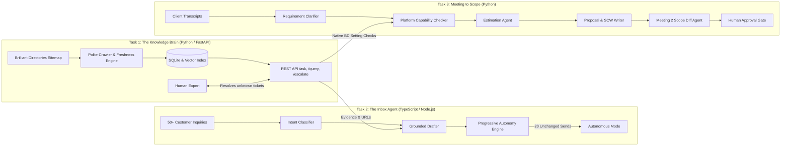

# AI Tech Consultant (BusinessLabs Capstone)

An end-to-end autonomous technical consulting suite built for software service businesses and SaaS agencies. It automates product knowledge retrieval from public help centers, accelerates customer support inbox triage with progressive autonomy, and converts unstructured client discovery transcripts into structured Scopes of Work (SOWs), effort estimates, and client-ready proposals.

---

## Architecture Overview



---

## One-Command Quick Start

### 1. Run All Three Services
On Windows, double-click or run:
```cmd
run.bat
```
This boots all three microservices in parallel:
- **Task 1: Knowledge Brain API & Web UI**: [http://127.0.0.1:8000](http://127.0.0.1:8000) (Swagger docs at `/docs`)
- **Task 2: Customer Inbox Review Dashboard**: [http://127.0.0.1:3000](http://127.0.0.1:3000)
- **Task 3: Meeting to Scope UI & API**: [http://127.0.0.1:8001](http://127.0.0.1:8001) (Swagger docs at `/docs`)

### 2. Run All Automated Tests
To execute test suites across all three tasks in one command:
```cmd
test_all.bat
```
*(Runs 25 automated unit & integration tests covering failure cases, schema validations, API integrations, and 60+ benchmark evaluations).*

---

## Key Modules

| Directory | Tech Stack | Role | Key Endpoints / Features |
|---|---|---|---|
| `task1-knowledge-brain/` | Python 3.11, FastAPI, SQLite, Scikit-learn, BeautifulSoup4 | Knowledge memory from Brilliant Directories help center | `/health`, `/api/v1/ask`, `/api/v1/query`, `/api/v1/escalations`, `/api/v1/sync` |
| `task2-inbox-agent/` | Strict TypeScript, Node.js 22, Express, Zod | Grounded email reply drafter with progressive autonomy | `/health`, `/api/emails`, `/api/emails/:id/draft`, `/api/emails/:id/review`, `/api/autonomy` |
| `task3-meeting-to-scope/` | Python 3.11, FastAPI, Pydantic | Multi-agent team converting transcripts to SOWs and diffs | `/health`, `/api/v1/pipeline/process`, `/api/v1/pipeline/diff`, `/api/v1/proposals/:id/approve` |

---

## Documentation Links
- [DESIGN.md](DESIGN.md): System architecture, tradeoffs, chosen vs. dropped features, model routing, failure modes.
- [EVALS.md](EVALS.md): Comprehensive evaluation framework with 20+ test cases per task, latency, accuracy, and cost breakdown.
- [AI_LOG.md](AI_LOG.md): Prompts log and critical AI rejection analysis.
- [docs/DEMO_SCRIPT.md](docs/DEMO_SCRIPT.md): 10-minute capstone video recording guide and live review prep.
